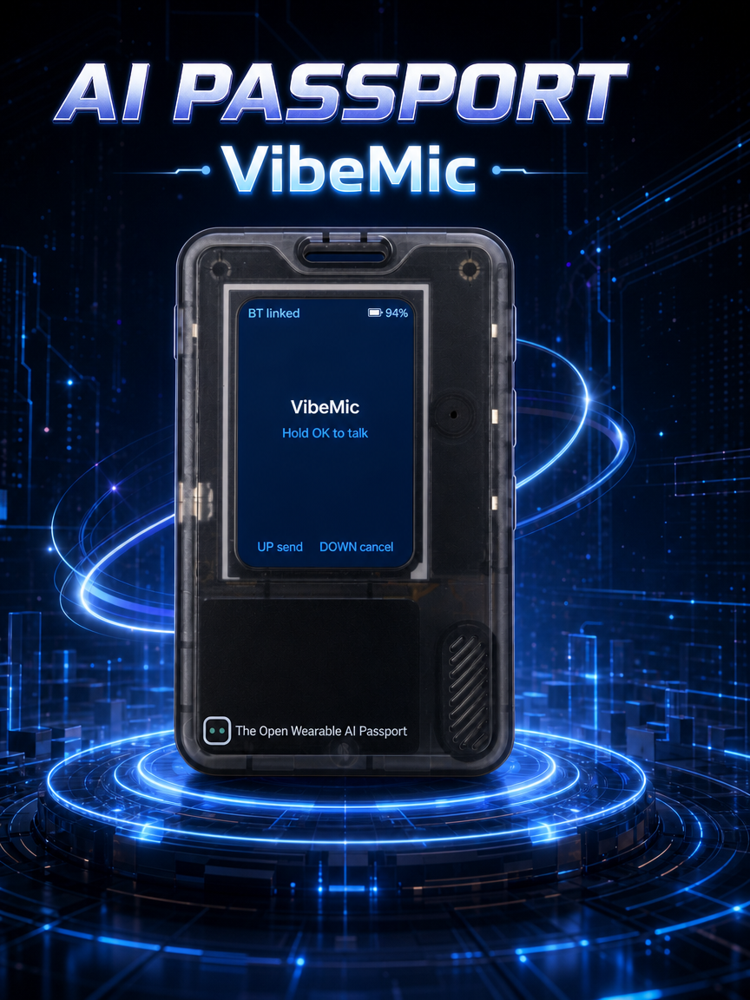

# Passport VibeMic

  

把 FoloToy AI Passport（ESP32-C3）变成 vibecoding 语音遥控器。

**按住 OK 说话** → 设备麦克风把音频经 BLE 串流到 PC → PC 本地识别（SenseVoice，离线）→ 文字键入当前焦点窗口；
**UP** 确认/发送（Enter 或 Ctrl+Enter，可配置），**DOWN** 取消（Esc）；桌面端 Rust（Tauri 2）负责设备链路、识别与按键分发。

> 命名约定：对外展示名（窗口标题、exe 名、文档正文）写 **VibeMic**；蓝牙广播设备名为
> `AI Passport Vibe Mic`（`AI Passport` 前缀对应硬件产品名，用户在系统蓝牙面板里一眼能认出归属）。
> 代码与路径类标识符（crate 名、`%APPDATA%\vibemic`、`vibemic.theme`、
> schema id `vibemic-profile-1`）一律保持小写 `vibemic`。

## 目录

| 目录 | 内容 | 技术栈 |
| --- | --- | --- |
| [`device/`](device/) | 手持设备固件 | FoloToy ai-passport 的 fork，ESP-IDF 5.5.3 + NimBLE |
| [`desktop/`](desktop/) | PC 端桌面软件 | Rust + Tauri 2 + Vue 3 |

## 当前状态

- `device/` —— BLE HID 键盘 + VibeMic 自定义服务、三键映射、主屏 UI、
  `BSP_BTN_RELEASE` 扩展、16kHz IMA-ADPCM 语音串流（20ms / 165B 一块）。
  ESP-IDF 5.5.3 构建与静态门禁通过，并已烧录到设备验证。
- `device/` 屏幕空闲策略：**1 分钟无操作亮度变暗（100% → 20%），3 分钟熄灭背光**；
  任意按键立刻回全亮，且这一次按键照常生效（唤醒不吞键）。录音（按住 OK）、
  删除手势与按住 DOWN 重置期间算持续活动，不会变暗。熄屏只关背光、不动面板
  （`Sleep In` 是 deep sleep 专用且不可恢复），按键即可点亮。
- `desktop/` —— Rust workspace：`vibemic-protocol`（帧 / 载荷 / ADPCM / profile，单测）、
  `vibemic-link`（WinRT 直连 / btleplug / 串口）、`vibemic-asr`（本地 SenseVoice 识别）、
  `vmctl` 验证 CLI，以及 Tauri 2 + Vue 3 桌面应用（托盘 + 悬浮窗，交付物只有 `VibeMic.exe`）。
- 已知约束：设备链路目前 **Windows-only**；串口通道缺少设备端帧服务；
  PC 会话活跃时 OK 只做 PTT 采集，不发设备内置档位宏。

构建与使用见 [`desktop/README.md`](desktop/README.md) 与 [`device/README.md`](device/README.md)。

## 许可证

本项目以 [MIT 许可证](LICENSE) 发布（Copyright (c) 2026 dashingmonkey）。

`device/` 目录是 [FoloToy/ai-passport](https://gitee.com/FoloToy/ai-passport) 的 fork，
沿用上游 MIT 许可证（Copyright (c) 2026 FoloToy），
原始许可文本保留在 [`device/LICENSE`](device/LICENSE)。
